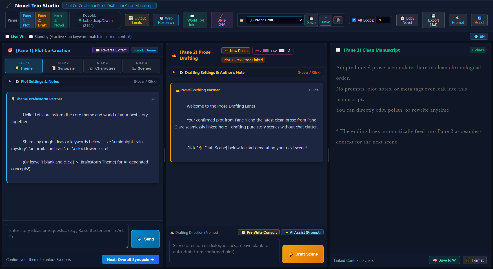
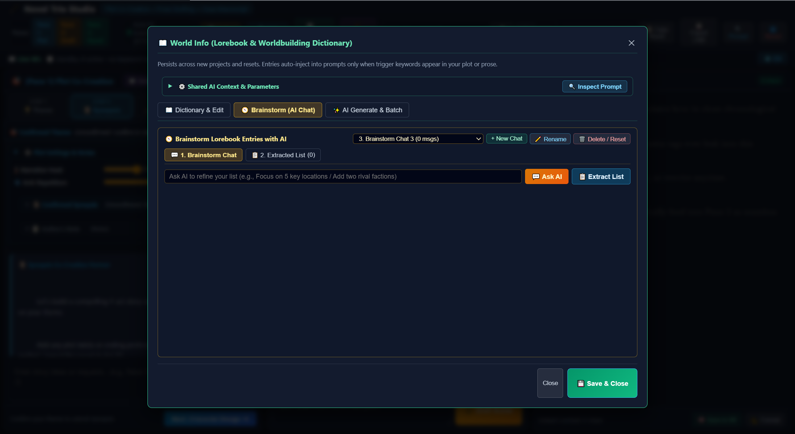
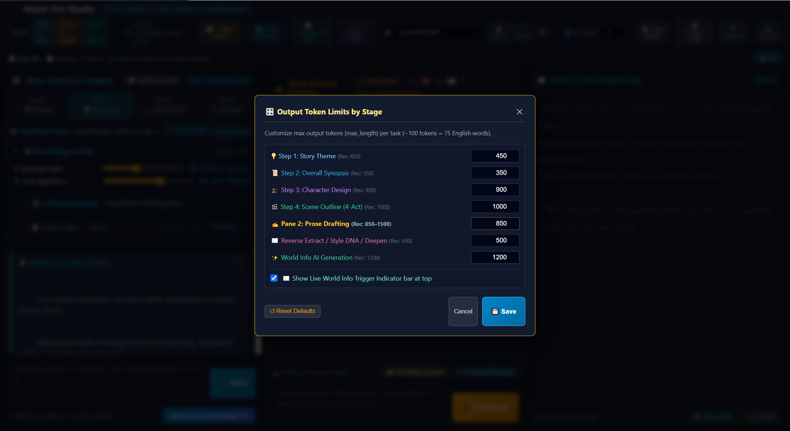
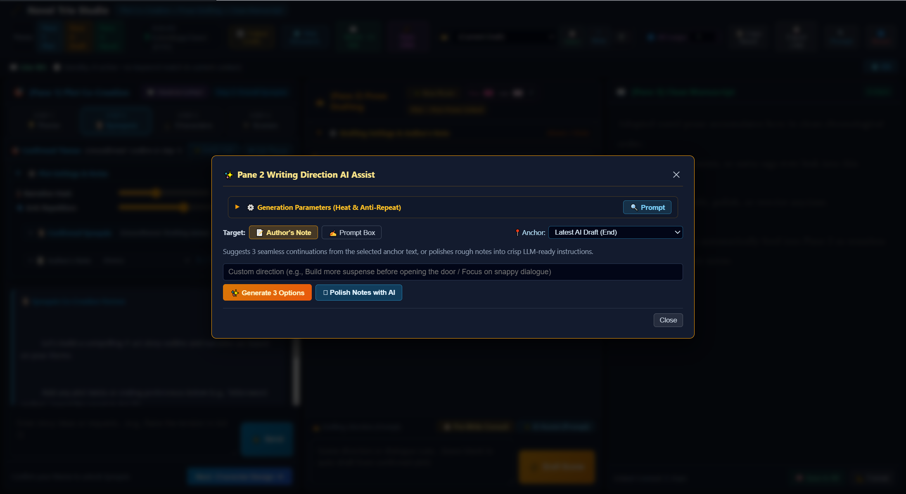

# Novel Trio Studio

> **A story isn't written in a straight line—it branches, compares, rewinds, and chooses again.**  
> **Novel Trio Studio** is a local-first AI fiction workstation built so **no great line, retry, or alternate route ever gets lost**—combining non-destructive branching, a silent 30× candidate generator, surgical context/World Info control, and a pure manuscript editor in one 3-pane studio.

[日本語版 README はこちら (Japanese)](README.ja.md) · [Join Waitlist](https://lever-architect.com/novel-studio/) · [Follow Updates on X (@MyAinoveLib)](https://x.com/MyAinoveLib)

---

## Why This Exists

Whether you're thinking *"Maybe I'll try writing a story,"* hitting a wall mid-chapter, or wishing you had a reader or editor to bounce *"What should happen next?"* off of—writing alone can stall fast.

**Novel Trio Studio** is designed so that simply conversing with the studio **clears the fog in your head and gets ideas flowing naturally**—and then **never loses a single spark** you uncover along the way:

- **Bounce ideas around until your story clicks** — Step lightly from a vague thought to Theme → Synopsis → Characters → 4-act beats, or talk through staging in the **Pre-Write Director Consult** when you feel stuck.
- **No lost sparks when you iterate** — You hit **Retry** 20 times to dig up *one* unforgettable sentence; instead of losing it to the next retry or drowning in `Story_01-02-alt-final2.txt` files, every branch and phrasing candidate stays preserved.
- **Clean separation of prompts & prose** — Your brainstorming, instructions, and finished novel text never get tangled together in a 200-message chat thread.
- **Long-term continuity without guesswork** — Early plot promises and world rules stay structured and visible, never silently truncated.

**Novel Trio Studio** brings all of this together as a dedicated **3-pane local-first workstation** (built for local LLMs / KoboldCpp).

---

## What Makes Novel Trio Studio Different

### 1. Non-Destructive Branching & Silent 30× Candidate Loop
- **Every retry & edit is a preserved branch**: Rewind to any turn, switch branches (`◀ / ▶`), or start a clean route without ever erasing your downstream scenes or phrasing candidates.
- **Silent Background Candidate Loop (1–30×)**: Lock your prompt and let the studio silently generate up to **30 complete alternatives** in the background while you keep reading or editing—then pick the best line later.
- **Dual-Color Continuation Diff**: When generating continuations (`Continue`), existing prose and newly generated text render in two distinct colors so you immediately see the seam.

### 2. Three-Pane Separation: Plot × Drafting × Pure Manuscript
Keep prompts, experiments, and finished prose strictly separated:
1. **Pane 1 — Plot Co-Creation (4-Step Gated Pipeline)**  
   Theme → Synopsis → Auto-Extracted Character Cards (auto-classified into always-on *Memory* vs keyword-triggered *World Info*) → 4-box `起・承・転・結` (4-act) Scene Editor—plus **Zoom-In Deep Dive** to expand a single beat at 5× detail without rewriting your whole outline.
2. **Pane 2 — Drafting & Branching Stream**  
   Edit any draft card inline, branch at any turn, or open the **Pre-Write Director Consult** (a branching brainstorming modal anchored to any scene) and **3-Angle Prompt Assist** (*Sensory/Psychology*, *Pacing/Plot*, *Gimmick/Description*) before generating.
3. **Pane 3 — Pure Confirmed Manuscript + "Prose → Memory" Distiller**  
   Only the lines you **Pin** enter your clean manuscript. As chapters grow, one click (**Confirmed Prose → World Info**) distills finished scenes back into structured lore entries so early plot promises are never forgotten.

### 3. Surgical Context, World Info & Token Control
- **AND-Gated + 3-Depth World Info**: Trigger lore entries with OR keywords, **AND required-keywords** (only fires when *all* conditions match), and 3 injection strengths (*Background / Normal / Strong*).
- **Live Firing Indicator**: Real-time badges light up *as you type your prompt* to show exactly which World Info entries and characters are injecting—zero black-box guessing.
- **Prompt Scope Controls**: Focus generation on *only* the active scene beat instead of dumping the whole outline, toggle individual character chips, and auto-prune stale chat history so local context windows stay crisp.
- **Built-in Anti-Repetition & Heat Controls**: Direct sliders tuned for **Temperature**, **Repetition Penalty**, **DRY**, and **XTC** sampling.

### 4. Built-In Research, PDF Library & Style DNA Tools (Zero External APIs Required)
- **PDF Reference Library + Style DNA Extractor**: Import reference novels (supports vertical & horizontal Japanese PDFs + OCR), search matching scenes via built-in thesaurus expansion, and extract a reusable **Style DNA Recipe**.
- **Reverse Plot Extractor**: Feed an existing chapter or draft to reverse-extract its 4-act beats, characters, theme, and synopsis straight into Pane 1.
- **Zero-API Deep Research → Cheat Sheets**: Gather factual background notes from multiple sources (stripping SEO/shop fluff) and distill them into reusable project cheat sheets.

---

## Preview

### 3-Pane Studio Workspace

### World Info & Structured Continuity Memory

### Live Token & Context Inspector

### Drafting, Branching & Assist Workflow

---

## Status & Waitlist

Novel Trio Studio is currently in **closed pre-release / waitlist** stage.

- **Waitlist & Early Access**: https://lever-architect.com/novel-studio/
- **Development Updates (X)**: https://x.com/MyAinoveLib
- **Roadmap**: See [ROADMAP.md](ROADMAP.md)

---

## Feedback & Feature Requests

If you write long-form web novels, light novels, or visual-novel / indie-game scripts and want specific export formats or workflow features supported, open an [Issue](../../issues/new/choose).

---

*Note: This repository is the public showcase, documentation, and feedback hub for Novel Trio Studio. Application source code is maintained privately.*
